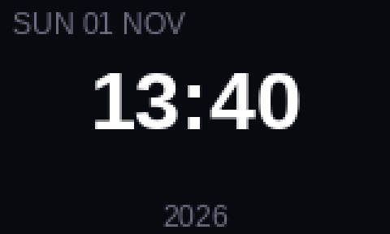
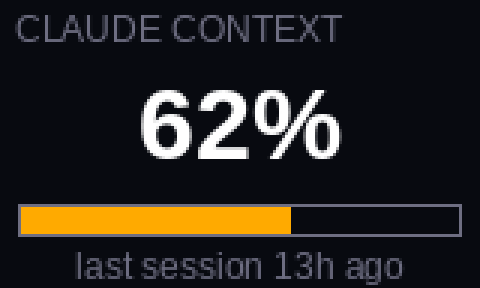
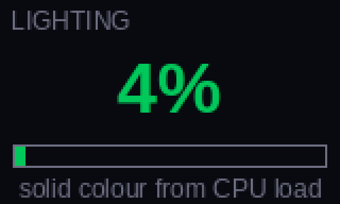

# hiska-keg450-lcd

Drive the **HISKA HX-KEG450** keyboard's 160×96 LCD and its RGB lighting from
Linux — no Windows, no vendor tool, no VM.


| | | |
|---|---|---|
|  |  |  |
| clock | Claude context usage | adaptive lighting |

The vendor only ships a Windows MFC application. This repository is the
reverse-engineered replacement: a small Python client that speaks the keyboard's
vendor HID protocol directly over `/dev/hidraw`, plus a renderer that pushes
changing content — clock, CPU load, Claude Code usage — to the panel.

## The family

| Repo | What it is |
|---|---|
| **hiska-keg450-lcd** (here) | Python CLI + protocol reference |
| [**hx450-studio**](https://github.com/securityvisions/hx450-studio) | Rust + egui desktop studio — canvas editor, GIF timeline, lighting, live providers |
| [**hx450-re**](https://github.com/securityvisions/hx450-re) | reverse-engineering kit — opcode atlas, firmware report, Ghidra evidence, gated prober |

## Features

- **Upload still images and animated GIFs** to the LCD — `PNG`, `JPG`, `GIF`
  (up to 255 frames), converted to the panel's RGB565 format.
- **RGB lighting control** — all 20 effects, solid colour, brightness, speed.
- **System settings** — disable Alt+Tab / Alt+F4 / Win, Fn momentary vs toggle,
  sleep timer, key debounce (`04 17`), with `--dry-run` that prints the exact bytes.
- **Live content** — a daemon that re-renders and pushes a frame on an interval:
  clock (aligned to the minute boundary), CPU/RAM/temperature, Claude Code context
  usage, or adaptive lighting driven by CPU load.
- **Pure `/dev/hidraw`** — no kernel module, no libusb, no root after one udev rule.
- **Full protocol documentation** — [`docs/PROTOCOL.md`](docs/PROTOCOL.md) for the
  implemented path, [`docs/CAPABILITIES.md`](docs/CAPABILITIES.md) for the complete
  feature matrix of the hardware.

## Requirements

- Linux with `hidraw`, and the keyboard on the **USB-C cable** (the panel is
  disabled over 2.4 GHz and Bluetooth).
- Python **3.10+**
- [Pillow](https://python-pillow.org/) (`python3-pil` / `pip install Pillow`)
- Your user in the `input` group

## Install

```bash
git clone https://github.com/securityvisions/hiska-keg450-lcd.git
cd hiska-keg450-lcd

sudo install -m644 udev/99-hiska-keg450.rules /etc/udev/rules.d/
sudo udevadm control --reload-rules
sudo udevadm trigger --subsystem-match=hidraw

sudo usermod -aG input "$USER"       # then log out and back in
```

Check that the keyboard is found:

```bash
./keg450.py info
```
```
image node  : /dev/hidraw6  (0xFF68, 4096-byte output)
control node: /dev/hidraw7  (0xFF13, 64-byte feature)
screen      : 160x96 RGB565, max 255 frames
```

## Usage

### Screen

```bash
./keg450.py testcard                 # 4-colour sanity card, proves the link works
./keg450.py upload logo.png          # one still frame (~1.2 s)
./keg450.py upload animation.gif     # up to 255 frames (~4 min for 225)
./keg450.py clock                    # push the local clock to the keyboard RTC
```

### RGB lighting

```bash
./keg450.py light --mode list                       # 20 effects
./keg450.py light --mode static --color ff00ff      # solid magenta
./keg450.py light --mode breath --color 00aaff --brightness 4 --speed 2
./keg450.py light --mode rolling --colorful         # rainbow palette
./keg450.py light --mode off                        # lights out
```

`--brightness` and `--speed` are `0-5`. `--colorful` selects the rainbow palette,
in which case `--color` is ignored.

### Settings

The keyboard stores its system settings behind `04 17` (sequence `04 18` → `04 17`
→ 64-byte block → `04 02`; unlike lighting there is no `04 F0`).

```bash
./keg450.py settings --dry-run                     # print the exact bytes, send nothing
./keg450.py settings                               # no flags: show the defaults it would send
./keg450.py settings --win-lock --alt-tab --alt-f4 # lock those shortcuts
./keg450.py settings --no-win-lock --fn-toggle toggle
./keg450.py settings --sleep 5 --debounce 4
```

`--fn-toggle momentary|toggle` · `--sleep off|1|5|30` (minutes) · `--debounce 1-5`.
There is no read-back, so every call sends a **complete block**: fields you leave
out fall back to the defaults (all locks off, Fn momentary, sleep off, debounce 3).

Honesty on confidence: the **field offsets** (block bytes 2/3/4 = Alt+Tab / Alt+F4 /
Win locks, 5 = Fn switch, 6 = sleep time, 8 = key response time, `AA 55` at 62–63)
are verified in the vendor binary (`FUN_004141a0`). The **value semantics** — which
sleep index is 1 vs 5 vs 30 minutes, momentary vs toggle, what debounce level 1–5
feels like — are inferred from the vendor UI strings and unconfirmed on hardware.

### Live display

```bash
./live.py --provider clock  --interval 60      # time and date, minute-aligned
./live.py --provider clock  --interval 60 --sync-clock
./live.py --provider sys    --interval 30      # CPU % / RAM / temp
./live.py --provider claude --interval 120     # Claude Code context usage
./live.py --provider text --text "BUILD OK" --once
./live.py --provider sys --preview /tmp/f.png  # render without touching the keyboard
```

Adaptive lighting — a solid colour that follows CPU load
(green < 40 % < amber < 75 % < red):

```bash
./live.py --provider light --also-light --interval 20
```

The clock provider schedules to the **next minute boundary + 1.2 s**, so the panel
flips within about a second of the minute changing instead of lagging behind. A
failed push is logged and the loop keeps going.

Add `--sync-clock` to also push the local time to the keyboard RTC (`04 28`) when
the loop starts and then once an hour. The panel shows the uploaded frame either
way; a correct RTC only matters when the keyboard's own clock display mode is
selected.

### Keep the clock live

The panel only stays live while something keeps pushing frames. Install the bundled
user unit:

```bash
mkdir -p ~/.config/systemd/user
cp contrib/systemd/hiska-keg450-live.service ~/.config/systemd/user/
systemctl --user daemon-reload
systemctl --user enable --now hiska-keg450-live.service
journalctl --user -u hiska-keg450-live -f
```

It runs `live.py --provider clock --interval 60`; edit `ExecStart` if you cloned the
repository somewhere other than `~/Personal/hiska-keg450-lcd` (`%h` is your home
directory). `Restart=always` brings the clock back after a suspend or a replug. Add
`--sync-clock` to the exec line to keep the keyboard's own RTC correct too.

## ⚠️ Limitations and flash wear

- **There is no framebuffer.** The screen holds one stored animation; "live"
  means re-uploading a frame. Each update takes ~1.2 s (8 pages of 4096 bytes).
- **Every upload rewrites the screen image in flash.** At a 30 s interval that is
  ~2 900 writes/day. Treat **30 s as the floor and 60 s+ as comfortable**.
  `live.py` refuses intervals below 10 s for this reason.
- **Wired only.** The vendor layout XML disables the screen menu in wireless mode,
  and the 2.4 GHz receiver exposes different vendor pages.
- **Colour depth is RGB565**, so smooth gradients will band.
- **One animation slot.** Uploading replaces the previous content.

## How it works

The keyboard presents four HID interfaces using Apple's USB IDs (`05ac:024f`).
Two are vendor-specific:

| Interface | Usage page | Reports | Role |
|---|---|---|---|
| MI_02 | `0xFF68` | in 64 B, **out 4096 B** | screen pages + per-page ACK `01 5A 02` |
| MI_03 | `0xFF13` | in/out/feature 64 B | commands and status |

An upload is `04 18` (begin) → `04 72` (metadata, page count) → N page writes →
`04 02` (commit), with 4096-byte pages converted to little-endian RGB565 and a
256-byte header carrying the frame count and per-frame delays. Lighting is
`04 18` → `04 13` → a 64-byte effect packet → `04 02` → `04 F0`. System settings
are `04 18` → `04 17` → a 64-byte settings block → `04 02`, with no `04 F0`.

Two Linux traps worth knowing: control reports need a **65-byte** ioctl buffer
(report-ID byte included) and image pages must be written as **4097** bytes, or
hidraw drops a byte on pages starting with `0x00`.

Byte-level reference: [`docs/PROTOCOL.md`](docs/PROTOCOL.md). The complete
reverse-engineered atlas (key remapping, macros, settings, per-key RGB, the
2.4 GHz dongle family) is in the
[RE kit](https://github.com/securityvisions/hx450-re).

## Troubleshooting

| Symptom | Fix |
|---|---|
| `HX-KEG450 not found` | Keyboard on the cable, not the dongle; check `ls /sys/class/hidraw/`; re-run the udev steps |
| `Permission denied` on `/dev/hidraw*` | udev rule not applied or you are not in `input` — log out and back in |
| `page N was not acknowledged` | Previous upload was interrupted; run the command again (content is rewritten atomically) |
| Lighting returns `ok` but nothing changes | You are on the cable and the keyboard is not in an onboard-effect lock; `./keg450.py light --mode off` then a mode again |
| Screen stays black after an upload | Confirm `commit: ok`, then press a key; the panel re-draws its stored animation |

## Compatibility

Tested on the **HISKA HX-KEG450** (firmware 1.06) only. The `0xFF13` + `0xFF68`
pair and the `04 xx` command family appear on other SONiX-based OEM LCD keyboards
(AULA, AJAZZ, Epomaker and relatives), but geometry, slot count and the
"colourful" flag are model-specific.

If you own a different board, start with `./keg450.py testcard`: if the colours
land correctly you are on the same protocol, and only `SCREEN_W` / `SCREEN_H` need
changing.

## Disclaimer

Unofficial, unaffiliated with HISKA. Everything here was derived from observing
vendor software traffic on owned hardware. Writes go to the keyboard's
configuration memory; there is always some risk when poking undocumented firmware.

## License

[MIT](LICENSE)
